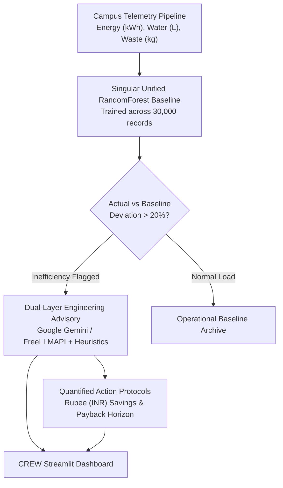

# CREW: Campus Resource Efficiency Watch

Campus Resource Efficiency Watch (CREW) is an operational intelligence and decarbonization engine designed for university campuses. It continuously monitors multi-domain utility telemetry across Electricity, Water, and Solid Waste, identifies operational anomalies using machine learning baselines, and produces prioritized, rupee-quantified engineering interventions with carbon abatement metrics.

---

## System Architecture



---

## Core Capabilities

1. **Multi-Domain Telemetry Modeling**:
   - Integrates 30,000 telemetry records spanning Electricity (`kWh`), Water Flow (`Liters`), and Solid & Organic Waste (`kg`).
   - Models diurnal consumption patterns across campus facilities including Academic Blocks, Computer Science & AI Labs, Robotics Workshops, Student Hostels, and Central Dining Facilities.

2. **Machine Learning Baseline**:
   - A singular unified `RandomForestRegressor` trained across 30,000 multi-domain records, achieving an empirical baseline fit of $R^2 = 0.9984$.
   - Predicts expected consumption as a function of facility attributes, time of day (24-hour diurnal cycle), and continuous occupancy headcounts.

3. **Deterministic Telemetry-to-Rupee Translation**:
   - Translates sensory deviations into localized commercial tariffs:
     - Electricity: Rs 8.50 per kWh (BESCOM commercial grid tariff)
     - Water: Rs 0.15 per Liter (BWSSB commercial supply rate)
     - Waste: Rs 12.00 per kg (BBMP commercial landfill surcharge)
   - Quantifies excess financial loss per hour, projected monthly budget waste, and Central Electricity Authority (CEA) carbon footprints (0.82 kg CO2e/kWh).

4. **Dual-Layer Engineering Diagnostics**:
   - Primary: Integrated Google Gemini Flash and FreeLLMAPI gateway for automated physical root-cause diagnoses, operational directives, and payback estimates.
   - Secondary: Deterministic domain-specific heuristics ensure zero downtime if external network connectivity is unavailable.

5. **Decision Support Dashboard**:
   - Spatio-temporal inefficiency heatmaps with granular hover tooltips (Recorded vs Baseline readings, Deviation percentage, Excess financial burn rate).
   - Diurnal financial waste spike curves highlighting peak campus loss windows.
   - Parasitic baseload ratio analytics isolating nighttime vampire power consumption.
   - "What-If" intervention simulator with live payback horizons and CSV action plan export.

---

## Campus Facility Hierarchy

| Facility ID | Facility Name | Category | Primary Baseline Load |
|---|---|---|---|
| `PU-ACAD-01` | Academic Block 1 (Engineering) | College | 45.0 kWh / 300 L/hr / 4.0 kg/hr |
| `PU-ACAD-02` | Academic Block 2 (Management & Law) | College | 35.0 kWh / 220 L/hr / 3.0 kg/hr |
| `PU-LIB-ADMIN` | Central Library & Admin Block | College | 28.0 kWh / 180 L/hr / 3.0 kg/hr |
| `PU-LAB-CS` | CS & AI Computing Center | College | 60.0 kWh / 80 L/hr / 2.5 kg/hr |
| `PU-LAB-ROBO` | Robotics & Mechanical Workshops | College | 40.0 kWh / 120 L/hr / 5.0 kg/hr |
| `PU-HOSTEL-BA` | Boys Hostel Block A | Hostel | 25.0 kWh / 500 L/hr / 6.0 kg/hr |
| `PU-HOSTEL-BB` | Boys Hostel Block B | Hostel | 24.0 kWh / 480 L/hr / 5.5 kg/hr |
| `PU-HOSTEL-G1` | Girls Hostel Block | Hostel | 22.0 kWh / 450 L/hr / 5.0 kg/hr |
| `PU-CANTEEN` | Central Food Court & Canteen | Canteen | 30.0 kWh / 400 L/hr / 25.0 kg/hr |

---

## Data Schema

The system standardizes telemetry into tabular records:

| Column | Type | Description |
|---|---|---|
| `building_id` | string | Unique facility identifier |
| `building_name` | string | Standardized campus facility title |
| `building_type` | string | Functional facility classification (`academic`, `lab`, `hostel`, `canteen`) |
| `facility_category` | string | Campus zone (`college`, `hostel`, `canteen`) |
| `zone` | string | Organizational zone representation |
| `group` | string | Sub-cluster grouping (e.g., `Academic & Admin Blocks`, `Labs`) |
| `occupancy` | integer | Active headcount at recorded timestamp |
| `hour` | integer | Diurnal timestamp (0 to 23) |
| `metric` | string | Monitored resource (`energy`, `water`, `waste`) |
| `reading` | float | Recorded sensory telemetry value |
| `known_inefficient` | boolean | Ground-truth flag for verified operational faults |

---

## Quickstart

### Prerequisites
- Python 3.11+
- Dependency management via `uv`

### Setup and Execution

1. Clone repository:
```bash
git clone https://github.com/poorvith-mp/crew.git
cd crew
```

2. Synchronize virtual environment:
```bash
uv sync
```

3. Configure environment variables (optional for live AI advisor):
Create `.env` in the project root:
```bash
GEMINI_API_KEY=your_api_key_here
FREELLM_BASE_URL=http://localhost:3001/v1
```

4. Launch the dashboard:
```bash
uv run streamlit run src/crew/app.py
```

5. Run test suite:
```bash
uv run pytest
```
