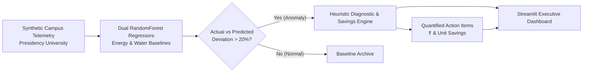

# CREW: Campus Resource Efficiency Watch ⚡💧

AI-powered telemetry analyzer that monitors campus energy and water consumption, flags operational anomalies, and recommends quantified, actionable interventions.

Built for the **IEEE 5-Hour Hackathon**.

---

## 🏗️ Architecture & Data Flow



---

## 📋 Data Contract (Locked Schema)

| Column | Type | Notes |
|---|---|---|
| `building_id` | string | Unique identifier per building or hostel block (e.g. `PU-ACAD-01`) |
| `building_name` | string | Real Presidency University Bengaluru facility name |
| `building_type` | string | `academic`, `lab`, `hostel`, `canteen` |
| `occupancy` | int | Real-time / hourly headcount associated with building |
| `hour` | int | 0 to 23 |
| `metric` | string | `"energy"` or `"water"` |
| `reading` | float | Actual recorded usage (kWh for energy, Liters for water) |
| `known_inefficient` | bool | `True` for rigged anomalies (nighttime leaks, chiller waste) |

---

## 👥 Hackathon Team Layers

| Layer | Owner | Component | Deliverable |
|---|---|---|---|
| **Layer 1: Data** | Member 1 | `crew.data_generator` | `data/campus_data.csv` matching locked schema |
| **Layer 2: Detection** | Member 2 | `crew.detection` | `RandomForestRegressor` with `predicted`, `deviation_pct`, `flagged` |
| **Layer 3: Recommendation** | Member 3 | `crew.recommendations` | Quantified financial & unit savings per anomaly + root cause diagnosis |
| **Layer 4: Dashboard** | Member 4 | `crew.app` | 3-Tab Streamlit application for judges and facility managers |

---

## 🚀 Quickstart

### 1. Requirements
- Python >= 3.11 (Managed via `uv`)

### 2. Generate Dataset
```bash
uv run python -m crew.data_generator
```

### 3. Run Detection Model
```bash
uv run python -m crew.detection
```

### 4. Launch Streamlit Dashboard
```bash
uv run streamlit run src/crew/app.py
```

### 5. Run Verification Tests
```bash
uv run pytest tests/
```
